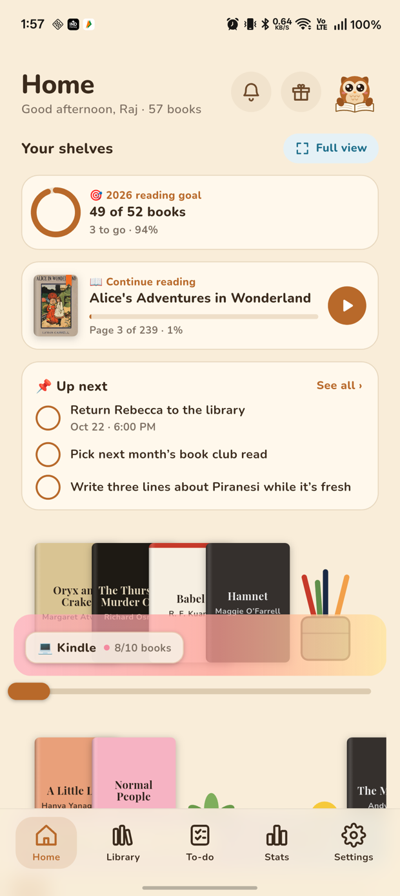
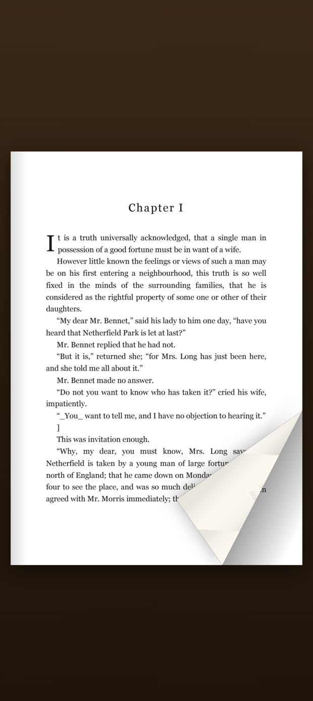
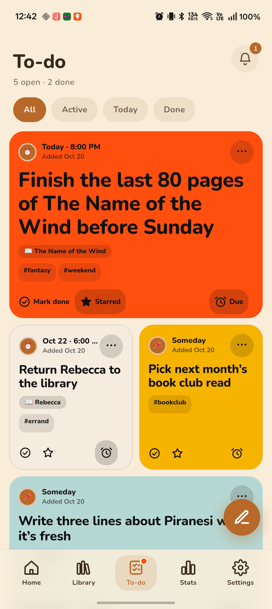

# Shelfwise 🦉📚

A cozy bookshelf and reading to-do app for Android, built with Flutter.

**Download:** grab the latest APK from the [releases page](https://github.com/RajkumarPadmanabhan/update-shelf/releases/latest), or visit the [website](https://rajkumarpadmanabhan.github.io/update-shelf/).

<p align="center">
  
  
  
  
  
</p>

## Features

- **Cozy shelves.** Overlapping book spines on pastel glass shelves. Press a book to lift it, long-press to drag it into a new spot, and use the slider to see every book. Each shelf holds 10 spots, with a sub shelf for 10 more.
- **Decorations you can play with.** Lamps switch on, candles light, the owl flies off and comes back, clocks ring and ducks squeak. All sounds are synthesised in the app.
- **Scan to add.** Point the camera at a barcode and the title, author, description and cover are filled in from Open Library (Google Books as fallback). You can also type the ISBN.
- **Read your own PDFs & EPUBs.** Pages curl over like paper when you drag a corner. Pinch or double-tap to zoom in place; while zoomed, swipe past the edge for the next page. EPUBs are typeset at the text size you choose. Bookmarks, page notes, and Shelfwise remembers where you stopped.
- **Reading time & goals.** Time spent in the reader is counted (it pauses when you're idle), and you can set a yearly book goal. Rate books with stars.
- **Reading to-do list.** Bento-style cards with due dates, reminders, stars, hashtags and a linked book.
- **Stats & Rewind.** See this month, this year or all time. Rewind plays a story-style recap you can share or save as an image, and your stats can be shared as a card.
- **Make it yours.** Light, dark or follow your phone; five accent colours; Nunito, Inter or Lora; three text sizes.
- **Rewards.** Milestones unlock badges, with confetti.
- **100% local.** No account, no ads. The internet is only used to check for updates and to look up books you scan. Use **Settings → Share backup** to save a backup, and **Settings → Import backup** on a new phone. Turn on **Include book files** to put your PDFs and EPUBs in the backup as a `.zip`.
- **Updates.** Shelfwise checks GitHub for new releases and installs them for you.

## Build

```bash
flutter pub get
flutter build apk --release --target-platform android-arm,android-arm64
```

Release builds are signed with the key referenced by `android/key.properties`, which is git-ignored. Without that file, the build falls back to the debug key.

## Workflow

Work happens on `dev`. Once a build has been tested on a device, `dev` is merged into `main`. Then a version tag is pushed (for example `git tag v1.2.0 && git push origin v1.2.0`), and the **Release APK** GitHub Action builds the signed APK and publishes the release with `shelfwise.apk` attached. Release notes come from `.github/release-notes/<tag>.md`. The website in `docs/` (GitHub Pages) reads the latest version from GitHub and links to the latest APK.

The Action signs with secrets `KEYSTORE_BASE64`, `KEYSTORE_PASSWORD`, `KEY_PASSWORD` and `KEY_ALIAS`, the same key as local builds, so updates install over older versions.

## Credits

The design is based on the "Readers" HTML mockup. The fonts (Nunito, Inter, Lora, Playfair Display and Caveat) are from Google Fonts under the SIL Open Font License.
